# C1 — original f0 layout restoration

Actual full application pages rendered in Chromium with the same deterministic DELL, MPC, VEEV, cash and checked-order fixtures. All API requests were fulfilled locally; no private account, provider data, account writes or brokerage activity were used. The example trade form was typed but never submitted. These are presentation checks, not investment-performance results.

**Before:** exact shipped production `53c1c6c` assets. **Historical reference:** exact source `f0d46ffceb98ba3fd5fca121beba6d8f23ccbdde`. **After:** optimized production build restoring the original layout slots while retaining current decisions and concise, informative reasons. Historical screenshots link to the existing exact-f0 gallery to avoid duplicating those files.

Opportunities

1440px full page

| Before 53c1c6c | Exact historical f0 | Restored layout |
| --- | --- | --- |
| [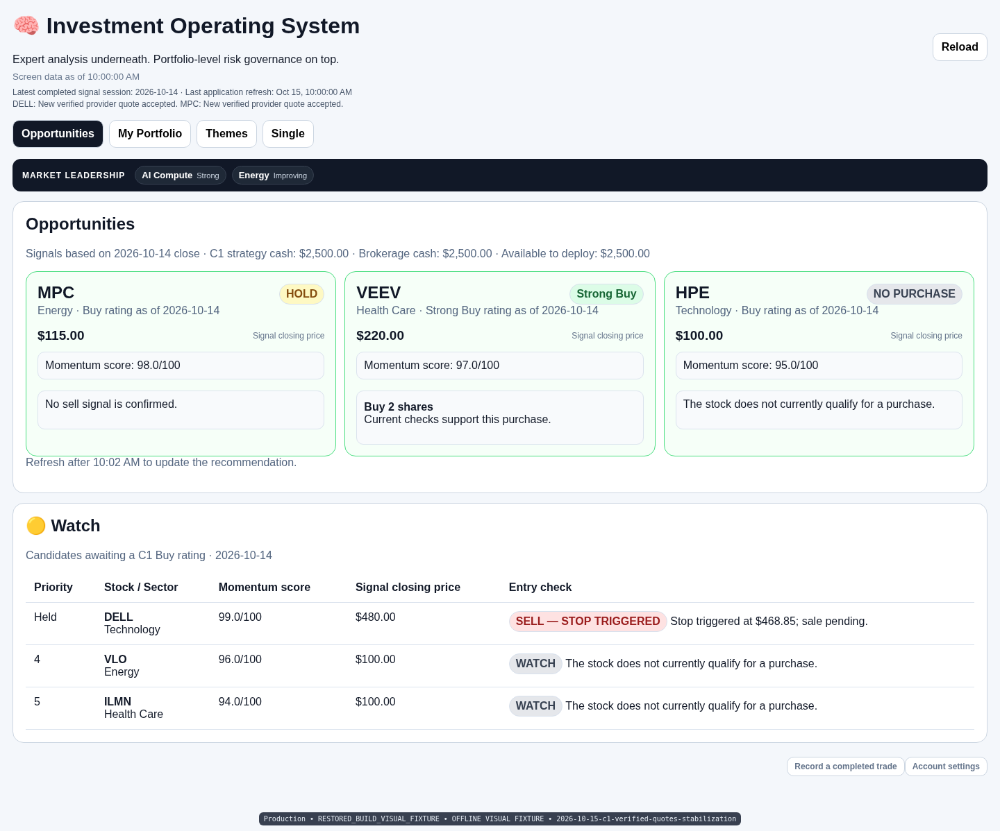](before-53c1c6c-opportunities-1440.png) |  | [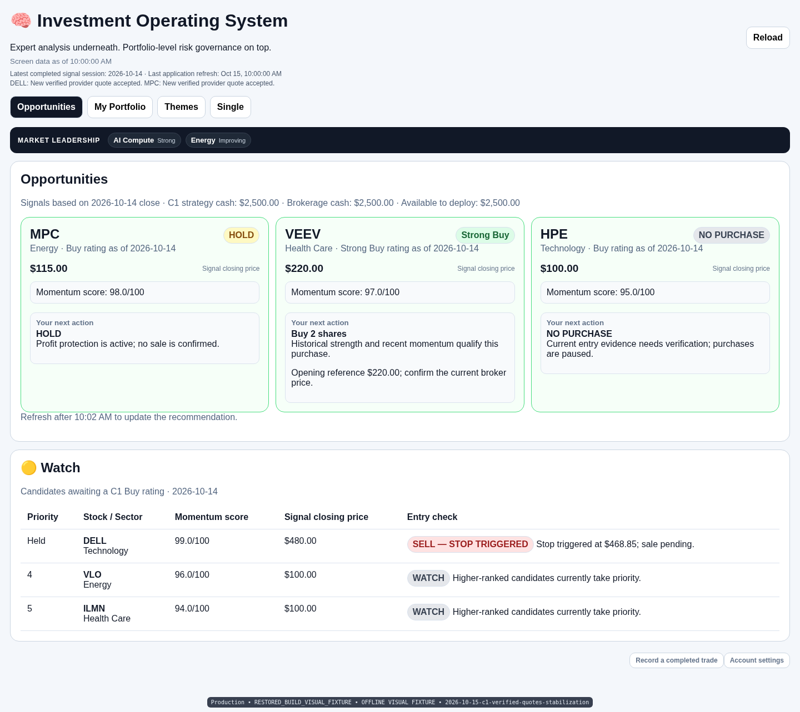](after-literal-opportunities-1440.png) |

390px full page

| Before 53c1c6c | Exact historical f0 | Restored layout |
| --- | --- | --- |
| [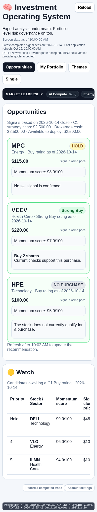](before-53c1c6c-opportunities-390.png) |  | [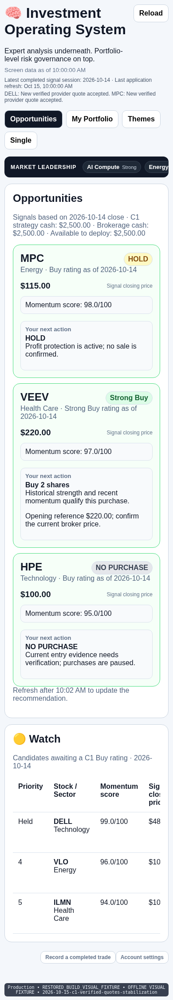](after-literal-opportunities-390.png) |

Portfolio

1440px full page

| Before 53c1c6c | Exact historical f0 | Restored layout |
| --- | --- | --- |
|  |  | [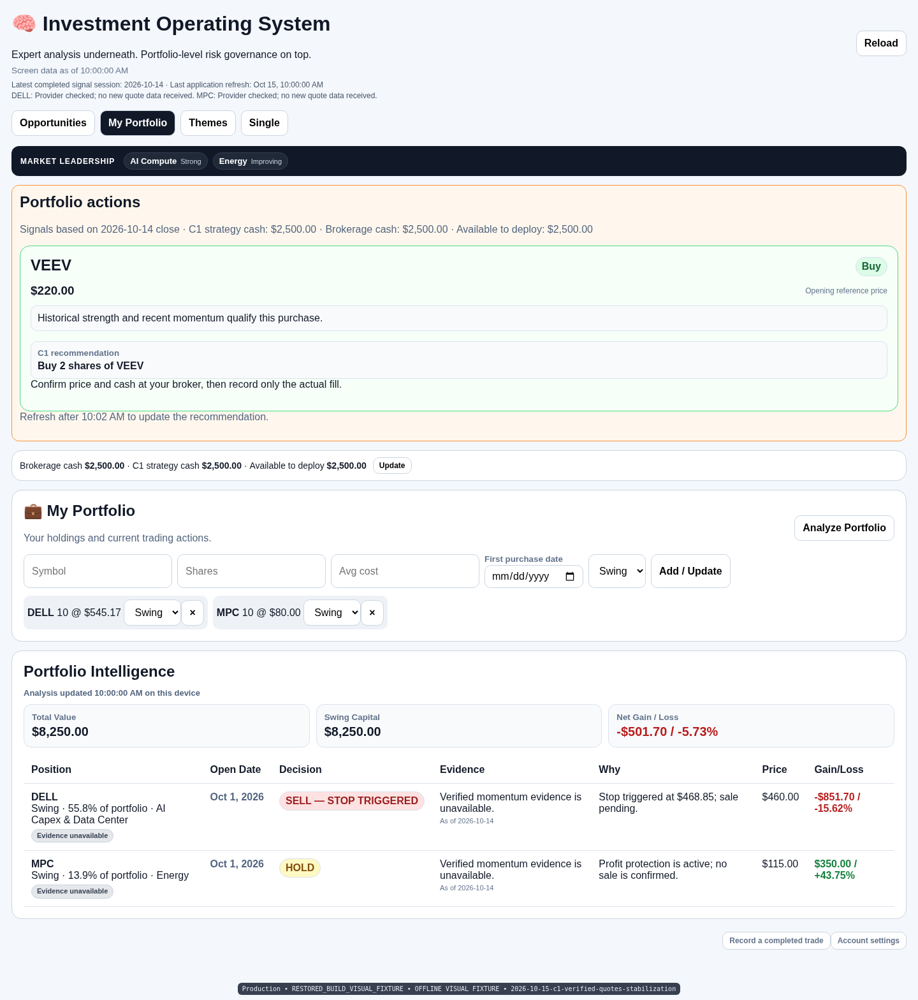](after-literal-portfolio-1440.png) |

390px full page

| Before 53c1c6c | Exact historical f0 | Restored layout |
| --- | --- | --- |
| [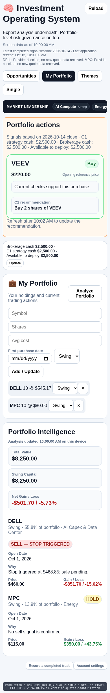](before-53c1c6c-portfolio-390.png) |  | [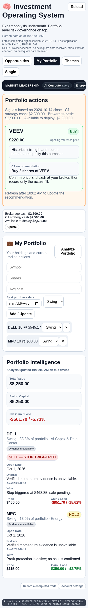](after-literal-portfolio-390.png) |

Themes

1440px full page

| Before 53c1c6c | Exact historical f0 | Restored layout |
| --- | --- | --- |
| [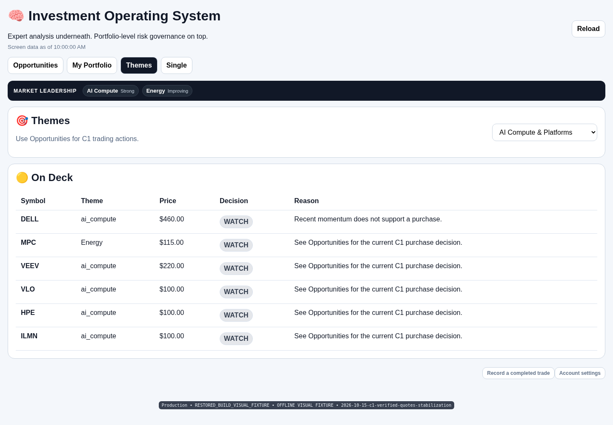](before-53c1c6c-themes-1440.png) |  | [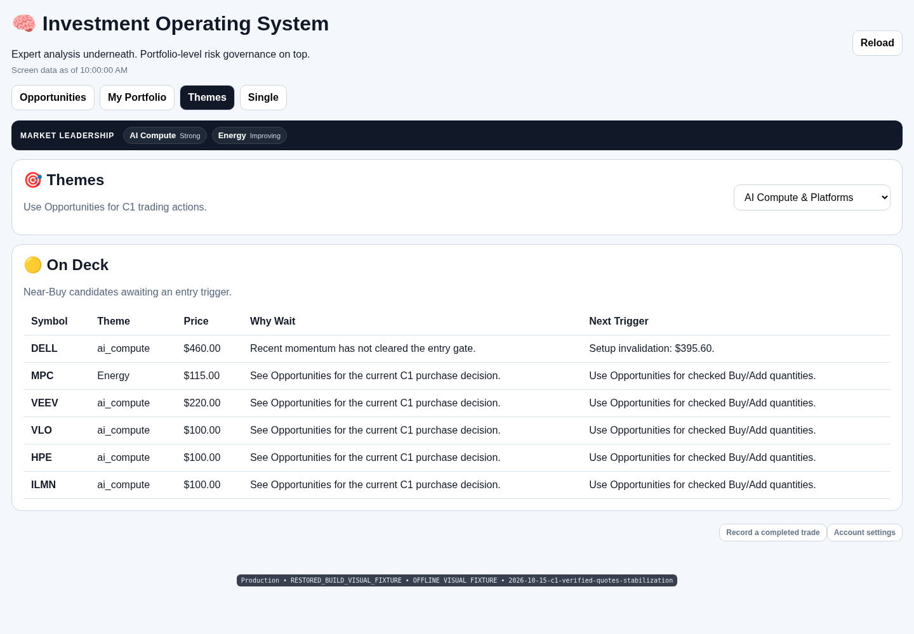](after-literal-themes-1440.png) |

390px full page

| Before 53c1c6c | Exact historical f0 | Restored layout |
| --- | --- | --- |
| [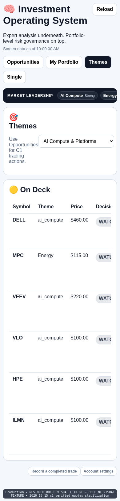](before-53c1c6c-themes-390.png) |  | [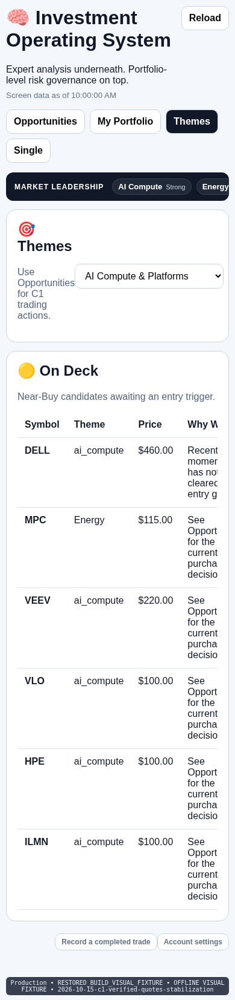](after-literal-themes-390.png) |

Single Symbol

1440px full page

| Before 53c1c6c | Exact historical f0 | Restored layout |
| --- | --- | --- |
| [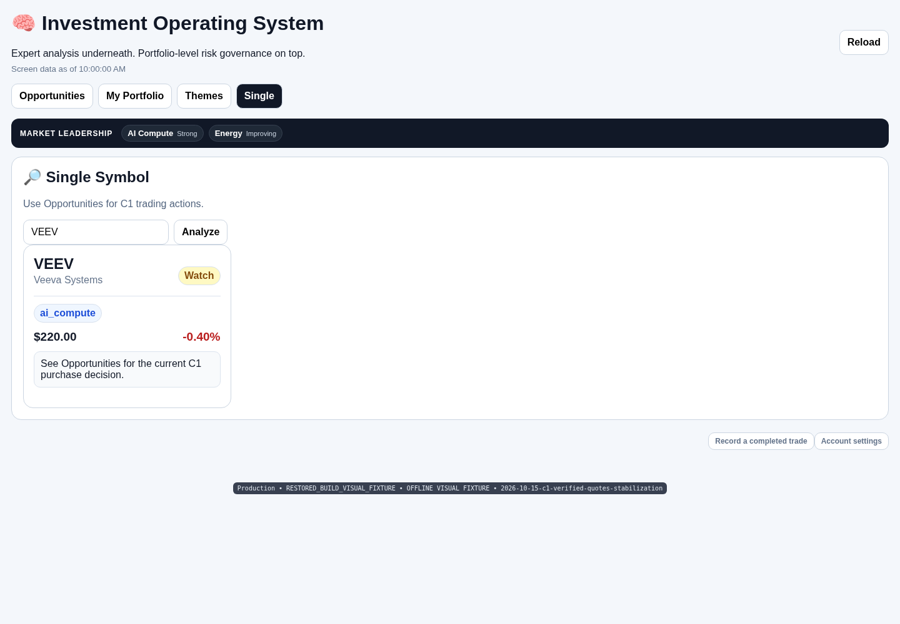](before-53c1c6c-single-1440.png) |  | [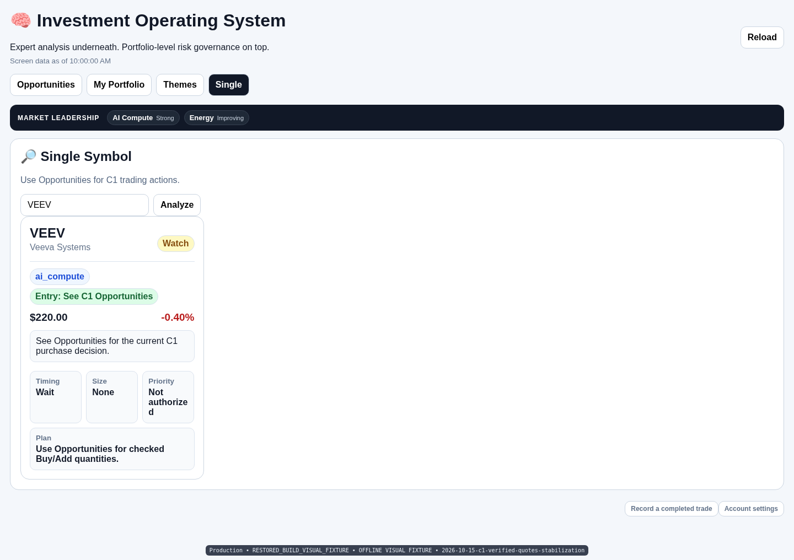](after-literal-single-1440.png) |

390px full page

| Before 53c1c6c | Exact historical f0 | Restored layout |
| --- | --- | --- |
| [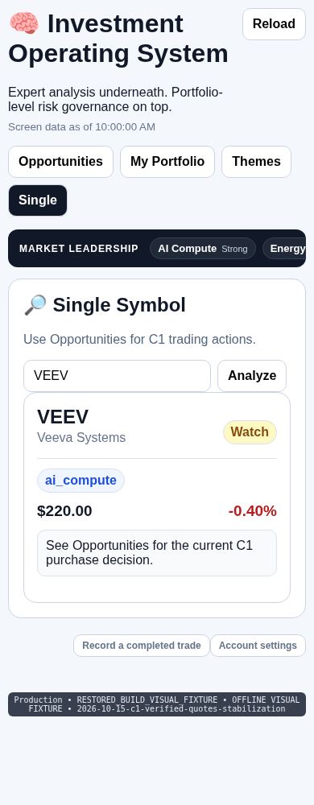](before-53c1c6c-single-390.png) |  | [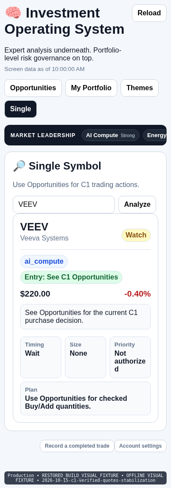](after-literal-single-390.png) |

Account settings

1440px full page

| Before 53c1c6c | Exact historical f0 | Restored layout |
| --- | --- | --- |
| [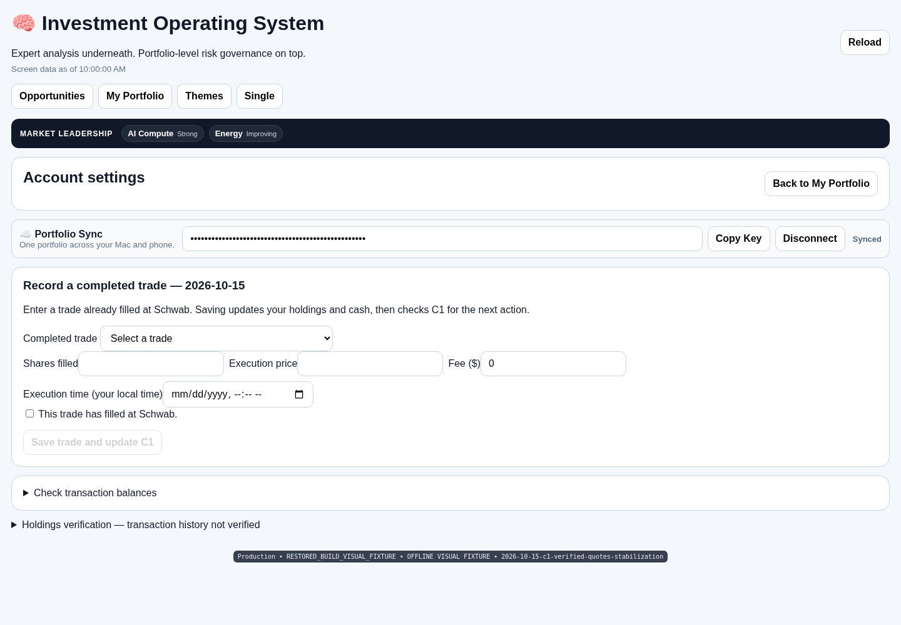](before-53c1c6c-account-settings-1440.png) |  |  |

390px full page

| Before 53c1c6c | Exact historical f0 | Restored layout |
| --- | --- | --- |
| [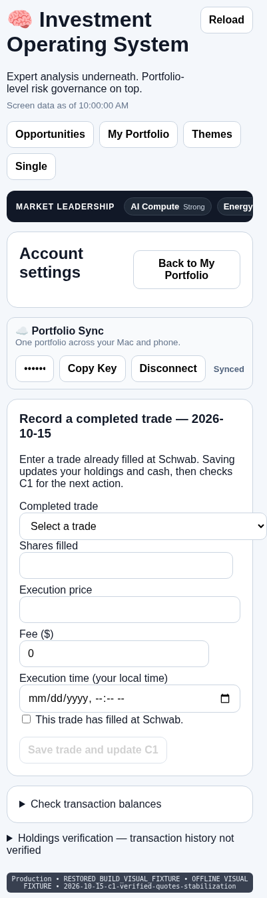](before-53c1c6c-account-settings-390.png) |  |  |

Completed-trade form

1440px full page

| Before 53c1c6c | Exact historical f0 | Restored layout |
| --- | --- | --- |
| [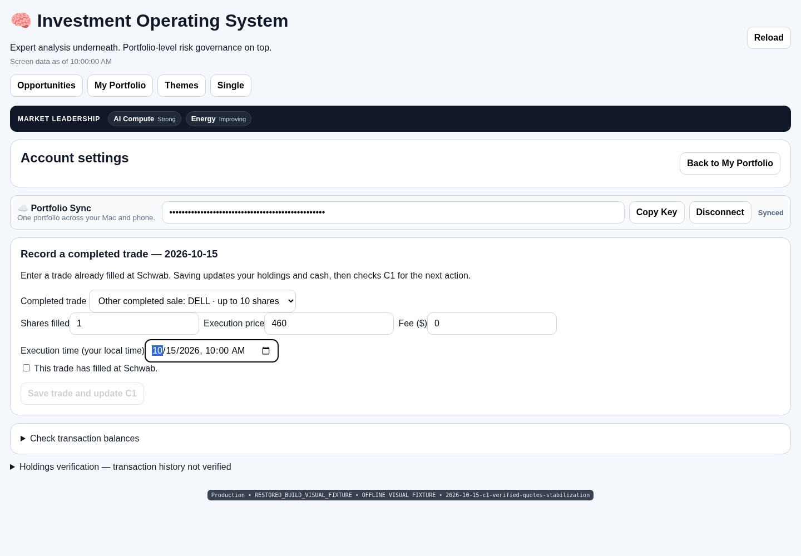](before-53c1c6c-activity-form-1440.png) |  |  |

390px full page

| Before 53c1c6c | Exact historical f0 | Restored layout |
| --- | --- | --- |
|  |  | [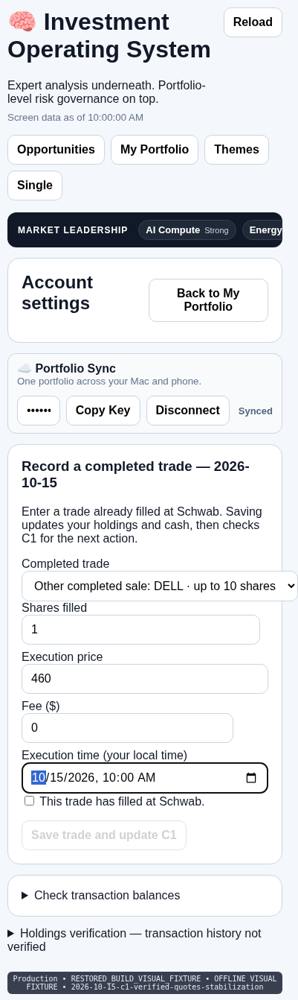](after-literal-activity-form-390.png) |

The original seven Portfolio columns, mobile Evidence/Why fields, Card Timing/Size/Priority/Plan boxes and Opportunity “Your next action” slots are restored. The original page, card and Opportunities CSS are checked against f0 by SHA-256; computed slot typography, padding, colors and dimensions are recorded in [verification.json](verification.json). All six views were checked at 1440, 390 and 360 px with zero browser errors and unchanged fixture holdings.

Current action labels, verified stops, checked quantities and concise explanation text are retained. Different current selections, text lengths, SELL labels and evidence naturally alter wrapping, table-column widths and page heights. This is not a claim that dynamic full pages are pixel-identical to historical f0.

The original Watch table retains internal horizontal scrolling. Existing mobile navigation/full-action wrapping safeguards remain. Original Account/activity form width and narrow Themes select behavior remain unchanged.
