# C1 — original green Opportunity cards and full SELL labels

Actual complete pages from the same deterministic DELL/MPC/VEEV/cash fixtures. All APIs were fulfilled locally. No private account, provider data, account changes or trades were used. This is UI compatibility evidence, not investment-performance evidence.

**Before:** exact published production 483aaf7 assets. **Reference:** exact historical f0d46ff source. **After:** optimized production build with the original three ranked green Opportunity frames and complete one-line SELL badges. The current action badges and checked quantities remain authoritative; green framing does not authorize capital.

## Opportunities

1440px full-page comparison

| Before 483aaf7 | Exact historical f0d46ff | After |
| --- | --- | --- |
| [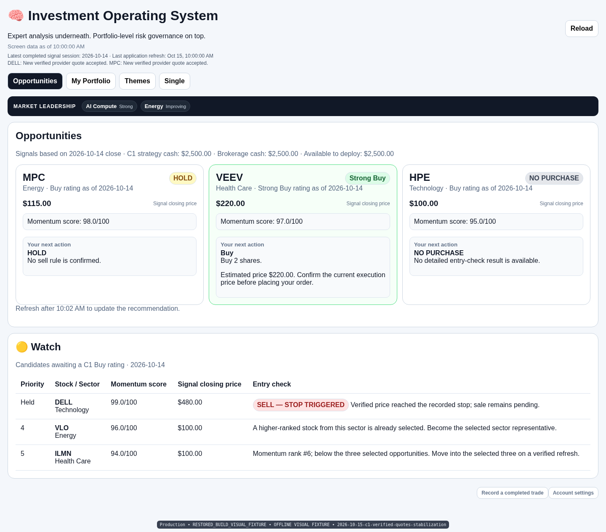](before-483aaf7-opportunities-1440.png) | [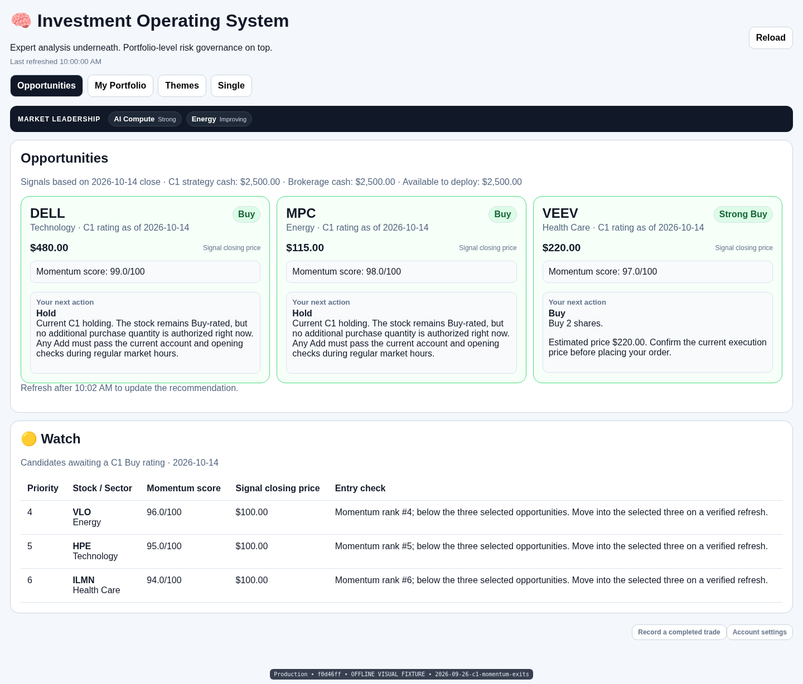](historical-f0-opportunities-1440.png) |  |

390px full-page comparison

| Before 483aaf7 | Exact historical f0d46ff | After |
| --- | --- | --- |
|  | [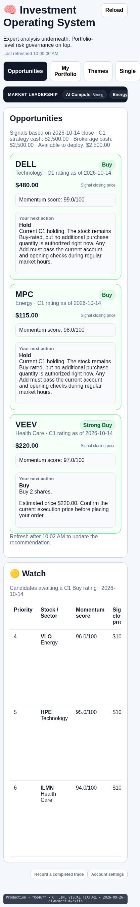](historical-f0-opportunities-390.png) | [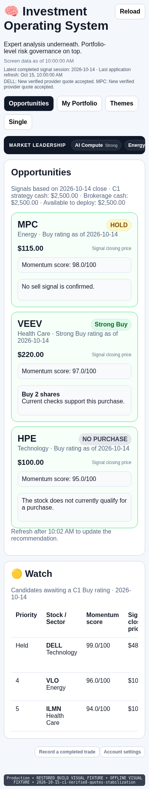](after-final-opportunities-390.png) |

360px full-page comparison

| Before 483aaf7 | Exact historical f0d46ff | After |
| --- | --- | --- |
| [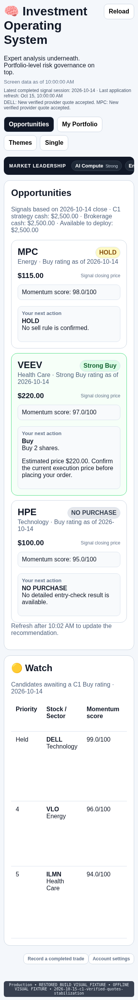](before-483aaf7-opportunities-360.png) | [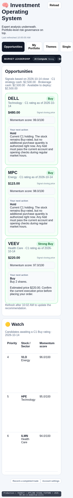](historical-f0-opportunities-360.png) | [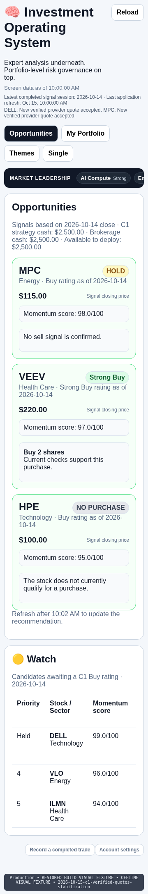](after-final-opportunities-360.png) |

## Portfolio

1440px full-page comparison

| Before 483aaf7 | Exact historical f0d46ff | After |
| --- | --- | --- |
| [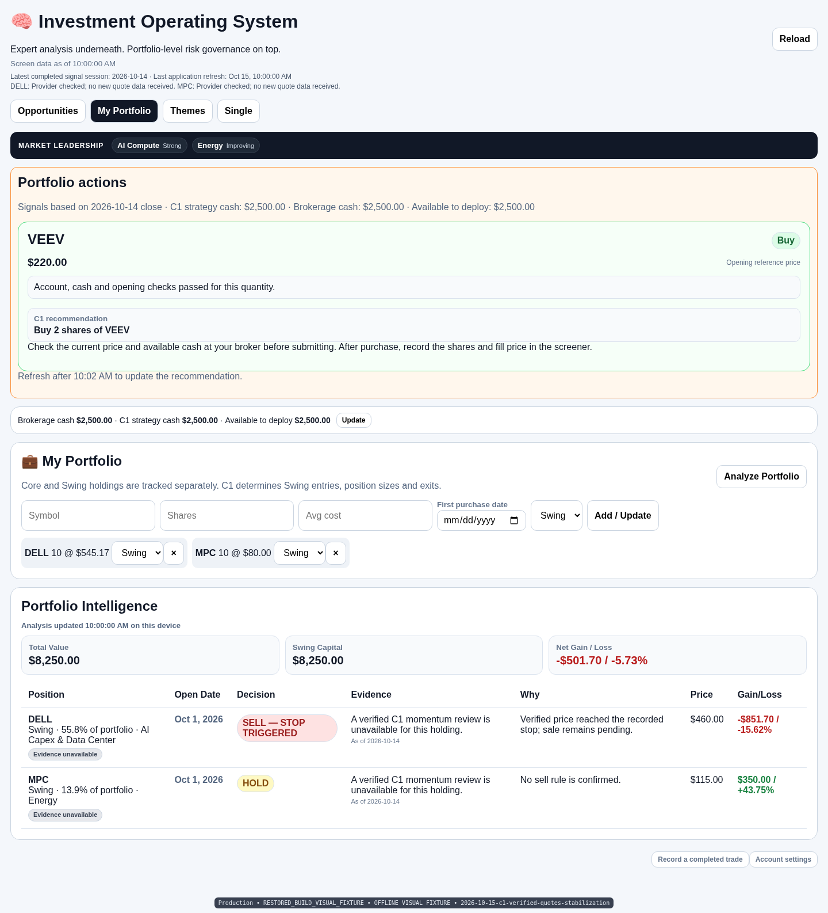](before-483aaf7-portfolio-1440.png) | [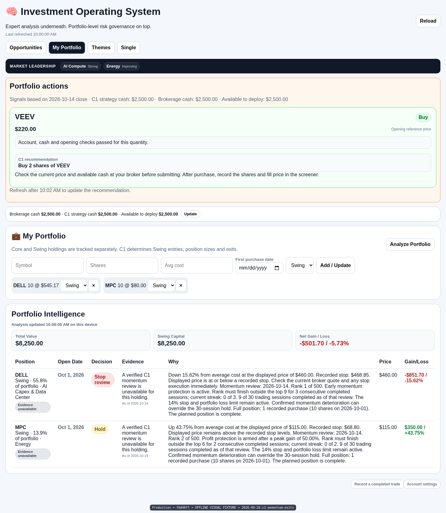](historical-f0-portfolio-1440.png) | [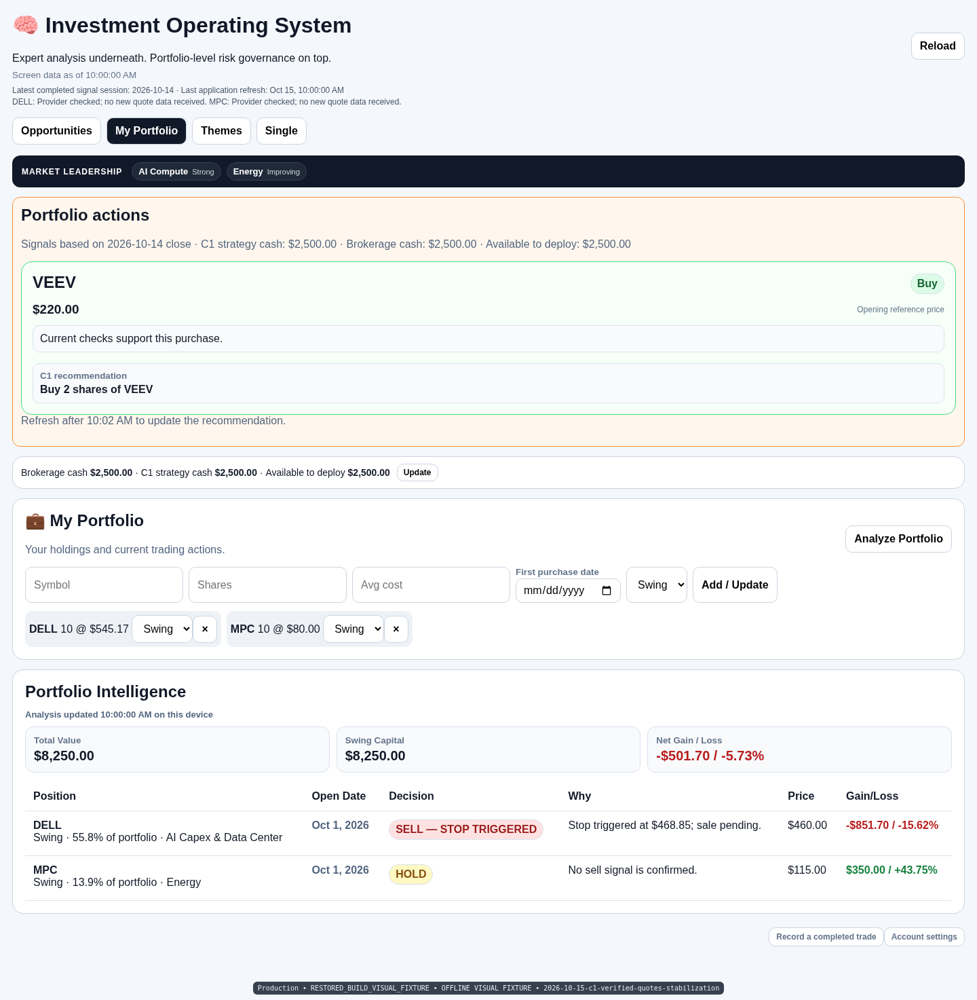](after-final-portfolio-1440.png) |

390px full-page comparison

| Before 483aaf7 | Exact historical f0d46ff | After |
| --- | --- | --- |
|  |  | [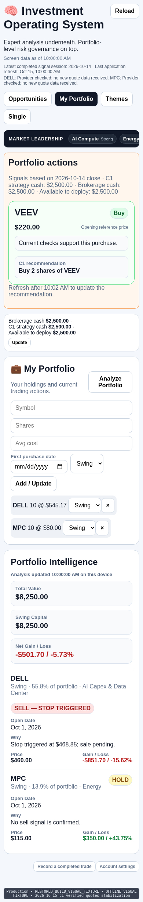](after-final-portfolio-390.png) |

360px full-page comparison

| Before 483aaf7 | Exact historical f0d46ff | After |
| --- | --- | --- |
| [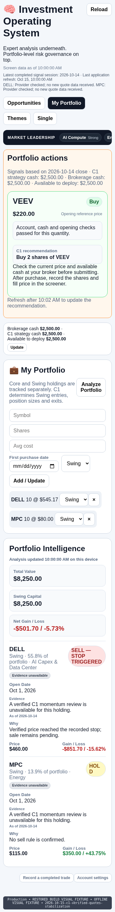](before-483aaf7-portfolio-360.png) | [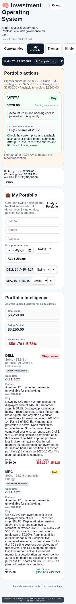](historical-f0-portfolio-360.png) | [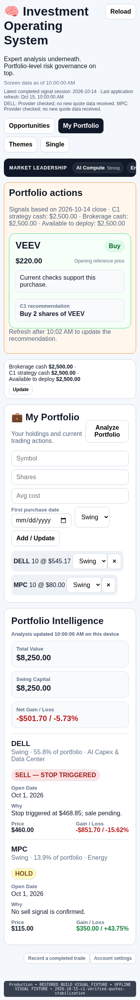](after-final-portfolio-360.png) |

Verification: [verification.json](verification.json). The original 9,578-byte page CSS and 1,562-byte card stylesheet remain byte-identical to historicalf0. The original card/table styling, auto-fit tiles, Watch table, typography and padding remain. The Portfolio technical Evidence column/badges and extended decision narratives are removed under the latest content-only instruction; action labels and short reasons remain. The original green class is restored; current action text uses one brief plain-English reason, and narrowly appended compatibility rules keep complete SELL labels together.

The same fixtures retain DELL **SELL — STOP TRIGGERED**, MPC **HOLD**, HPE **NO PURCHASE** and a checked **Buy 2 shares of VEEV**. Stop/profit-protection/momentum-exit labels were also measured at 1440/390/360: full badges are 228.0/253.5/221.5px wide and 30px high at the existing 16px font, one line without clipping. On mobile the full badge can occupy a new header row rather than breaking its text.

All 18 full-page after cases completed without page/console errors or fixture-holding changes. Original Watch horizontal scrolling remains. Original Account/activity 401px and narrow Themes 371px form overflow are unchanged from the previous literal restoration and outside this correction.
