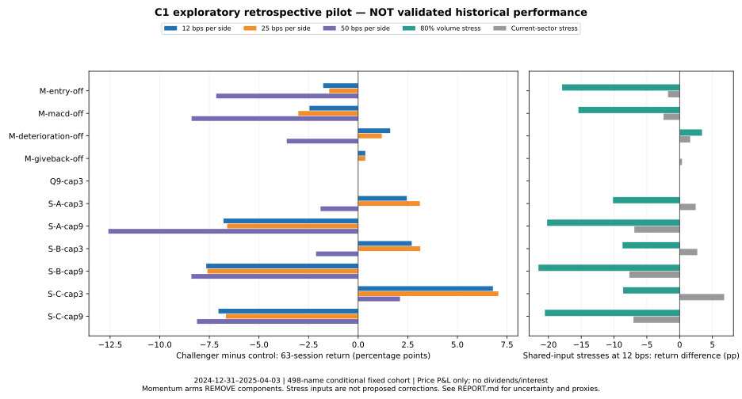

# Exploratory retrospective C1 pilot — not validated historical performance

Current-policy control and 11 frozen challengers, 2024-12-31 through 2025-04-03 (63 returns; first execution 2025-01-02). $100,000 hypothetical C1 equity excluding MSTR, separate $25,000/$50,000/$25,000 books. All 72 prespecified primary/stress runs completed. No live holdings, account history, production policy, or strict qualification gates changed. Draft PR #277 remains research only.

**Pilot decisions:** 0 KEEP, 11 INVESTIGATE, 0 REJECT under the frozen thresholds. The 10–30%/three-capacity arm leads the base sizing cases but loses its advantage under the volume stress. Nine-capacity sizing covers more candidate-days but trails the control at every primary cost. No strategy adoption is supported by this pilot.

## Decisions

KEEP retains a research candidate only; INVESTIGATE is inconclusive; REJECT rejects this pilot case only. Momentum labels are **removal ablations**: an ablation doing better is evidence against the removed component in this sample. Current production remains unchanged regardless of label. Strategy parameters, thresholds and comparison assumptions were frozen before returns were inspected. The conservative interpretation requiring drawdown/turnover safety checks at all three costs was documented during execution, after control results, rather than selecting a favorable cost.

| Research change | Pilot decision | ΔCAGR 12 / 25 / 50 bps (pp) | Paired 95% ΔCAGR interval, 12 bps (pp) | Holm p |
|---|---|---:|---:|---:|
| M-entry-off | INVESTIGATE | -6.89 / -5.54 / -28.12 | [-246.33, 71.52] | 1.0000 |
| M-macd-off | INVESTIGATE | -9.50 / -11.19 / -32.42 | [-212.16, 42.77] | 1.0000 |
| M-deterioration-off | INVESTIGATE | 6.62 / 4.69 / -14.88 | [-112.46, 44.14] | 1.0000 |
| M-giveback-off | INVESTIGATE | 1.45 / 1.41 / 0.00 | [0.00, 4.97] | 1.0000 |
| Q9-cap3 | INVESTIGATE | 0.00 / 0.00 / 0.00 | [0.00, 0.00] | 1.0000 |
| S-A-cap3 | INVESTIGATE | 10.18 / 12.64 / -8.03 | [-173.10, 68.69] | 1.0000 |
| S-A-cap9 | INVESTIGATE | -24.63 / -23.24 / -45.77 | [-250.94, 20.48] | 1.0000 |
| S-B-cap3 | INVESTIGATE | 11.25 / 12.72 / -8.96 | [-112.26, 63.58] | 1.0000 |
| S-B-cap9 | INVESTIGATE | -27.44 / -26.36 / -32.45 | [-255.33, 16.67] | 1.0000 |
| S-C-cap3 | INVESTIGATE | 30.02 / 30.40 / 9.45 | [-26.95, 110.25] | 1.0000 |
| S-C-cap9 | INVESTIGATE | -25.46 / -23.45 / -31.49 | [-238.06, 15.84] | 1.0000 |

Only one short, selected market interval is available under the declared proxy profile. Annualized CAGR magnifies short-period changes. Paired stationary block bootstrap (20-session expected blocks, 10,000 replicates, shared indices, seed 20261016) and 11-comparison Holm adjustment do not capture unknown events, membership/classification error, vendor revisions, development hindsight, or ex-post cohort exclusions. CAGR intervals are nominal paired percentile 95% intervals; Holm-adjusted p-values test one-sided mean daily-return superiority across the 11 arms at 12 bps. The 25/50-bps grids are cost stresses, not additional primary discovery tests. Roughly three effective blocks provide weak long-horizon evidence. No validated superiority or historical production replay is claimed.

## Primary investment results

Returns below are **portfolio price P&L after modeled per-side execution costs**, not verified total investment returns: dividends, cash interest and tax are omitted. No end-of-window forced liquidation; liquidation sensitivity is in comparative-results.json. Sharpe uses zero risk-free rate and √252; drawdown is negative; turnover is annualized gross buy-plus-sell notional/mean equity; utilization is one minus mean daily closing cash weight.

| Arm | Cost/side bps | Return | CAGR | Sharpe | Max drawdown | Annual turnover | Cash utilized | Modeled cost $ | Fills |
|---|---:|---:|---:|---:|---:|---:|---:|---:|---:|
| C | 12 | 0.70% | 2.79% | 0.24 | -19.26% | 30.08× | 62.42% | 988.84 | 89 |
| C | 25 | -0.39% | -1.52% | 0.10 | -19.70% | 30.11× | 62.45% | 2049.70 | 89 |
| C | 50 | 3.57% | 14.78% | 0.62 | -15.79% | 29.56× | 62.84% | 4011.33 | 87 |
| M-entry-off | 12 | -1.06% | -4.09% | -0.03 | -16.59% | 29.98× | 62.61% | 915.45 | 83 |
| M-entry-off | 25 | -1.85% | -7.06% | -0.15 | -16.86% | 29.96× | 62.61% | 1897.98 | 83 |
| M-entry-off | 50 | -3.58% | -13.34% | -0.42 | -17.31% | 29.97× | 62.60% | 3760.87 | 83 |
| M-macd-off | 12 | -1.75% | -6.71% | -0.04 | -14.21% | 37.95× | 63.39% | 1180.86 | 107 |
| M-macd-off | 25 | -3.40% | -12.71% | -0.24 | -15.04% | 38.51× | 63.91% | 2478.02 | 109 |
| M-macd-off | 50 | -4.82% | -17.64% | -0.43 | -15.80% | 38.38× | 63.64% | 4900.22 | 107 |
| M-deterioration-off | 12 | 2.32% | 9.42% | 0.46 | -14.85% | 19.62× | 63.06% | 628.62 | 57 |
| M-deterioration-off | 25 | 0.80% | 3.17% | 0.25 | -15.61% | 19.82× | 62.12% | 1317.46 | 58 |
| M-deterioration-off | 50 | -0.02% | -0.10% | 0.14 | -15.78% | 19.86× | 61.96% | 2624.56 | 59 |
| M-giveback-off | 12 | 1.06% | 4.24% | 0.29 | -18.97% | 30.11× | 62.36% | 989.94 | 89 |
| M-giveback-off | 25 | -0.03% | -0.11% | 0.15 | -19.41% | 30.13× | 62.39% | 2051.97 | 89 |
| M-giveback-off | 50 | 3.57% | 14.78% | 0.62 | -15.79% | 29.56× | 62.84% | 4011.33 | 87 |
| Q9-cap3 | 12 | 0.70% | 2.79% | 0.24 | -19.26% | 30.08× | 62.42% | 988.84 | 89 |
| Q9-cap3 | 25 | -0.39% | -1.52% | 0.10 | -19.70% | 30.11× | 62.45% | 2049.70 | 89 |
| Q9-cap3 | 50 | 3.57% | 14.78% | 0.62 | -15.79% | 29.56× | 62.84% | 4011.33 | 87 |
| S-A-cap3 | 12 | 3.16% | 12.98% | 0.73 | -12.72% | 16.81× | 33.30% | 540.09 | 93 |
| S-A-cap3 | 25 | 2.72% | 11.12% | 0.65 | -12.86% | 16.75× | 33.21% | 1119.09 | 93 |
| S-A-cap3 | 50 | 1.68% | 6.75% | 0.44 | -13.22% | 16.73× | 33.17% | 2221.77 | 93 |
| S-A-cap9 | 12 | -6.08% | -21.84% | -0.81 | -16.43% | 34.24× | 60.86% | 1048.25 | 239 |
| S-A-cap9 | 25 | -6.99% | -24.76% | -0.95 | -16.86% | 34.18× | 60.84% | 2169.11 | 239 |
| S-A-cap9 | 50 | -9.01% | -30.99% | -1.25 | -17.63% | 34.07× | 60.59% | 4267.54 | 239 |
| S-B-cap3 | 12 | 3.40% | 14.04% | 0.69 | -15.36% | 21.13× | 41.60% | 688.87 | 95 |
| S-B-cap3 | 25 | 2.74% | 11.21% | 0.58 | -15.67% | 21.13× | 41.61% | 1430.29 | 95 |
| S-B-cap3 | 50 | 1.45% | 5.83% | 0.36 | -16.23% | 21.11× | 41.61% | 2839.98 | 95 |
| S-B-cap9 | 12 | -6.95% | -24.64% | -0.99 | -16.52% | 36.03× | 63.49% | 1095.48 | 193 |
| S-B-cap9 | 25 | -7.98% | -27.87% | -1.16 | -17.01% | 36.01× | 63.50% | 2267.63 | 193 |
| S-B-cap9 | 50 | -4.83% | -17.67% | -0.62 | -13.88% | 33.68× | 62.92% | 4272.40 | 188 |
| S-C-cap3 | 12 | 7.49% | 32.82% | 1.22 | -15.06% | 24.66× | 49.86% | 824.49 | 93 |
| S-C-cap3 | 25 | 6.67% | 28.88% | 1.10 | -15.45% | 24.66× | 49.90% | 1711.14 | 93 |
| S-C-cap3 | 50 | 5.68% | 24.23% | 0.97 | -15.55% | 24.18× | 50.06% | 3334.22 | 91 |
| S-C-cap9 | 12 | -6.34% | -22.67% | -0.85 | -16.07% | 36.80× | 64.95% | 1115.44 | 162 |
| S-C-cap9 | 25 | -7.05% | -24.96% | -0.95 | -16.59% | 36.83× | 65.20% | 2317.82 | 160 |
| S-C-cap9 | 50 | -4.55% | -16.71% | -0.49 | -16.74% | 35.90× | 65.08% | 4601.53 | 164 |

The queue-only Q9-cap3 arm has exactly identical trades, daily curves and final books to C at every primary cost. Broader screen eligibility alone did not change investments under preserved projection-before-screen sequencing and three-per-book capacity in this pilot. This does not prove it will always be inert.

The 50-bps control has a better ending return than lower-cost controls because costs alter discrete rule paths. On 2025-02-26 the base sleeve crosses the unchanged 12% breaker at 50 bps (-12.0761% versus -11.7387% at 12 bps and -11.7442% at 25 bps), sells LULU/DXCM, and enters cooldown. This is not evidence that fees help; it demonstrates threshold sensitivity. Independent control replay reconciles every daily mark and final sleeve book to <$0.000001, with actual maximum difference $2.91e-11.

## Data-assumption sensitivity

All arms share each changed assumption. Values are challenger minus same-scenario control CAGR in percentage points at 12 bps. The sector stress substitutes current-provider labels for 456/498 names, changing 292 labels; 42 retain the dated labels, so this is a deliberately imperfect mixed-taxonomy/date stress, not historical reclassification evidence. The event-blocked scenario is an all-cash omission bound from a cash seed, not a realistic event calendar or superiority test.

**Absolute control returns at 12 bps:** base 0.70%; volume80 11.85%; current-sector stress 0.70%; events-blocked 0.00%. The leading base-case sizing arm S-C-cap3 returns 3.24% under volume80, versus that scenario's control 11.85%; its apparent lead reverses. The first volume-driven trade divergence is January 2: WBD's calculated average dollar volume falls from $326.545m to $261.236m under the prespecified stress, crossing the unchanged $300m gate. This does not prove the vendor figure is wrong, and the 80% scale must not be selected as a strategy improvement.

| Arm | Base ΔCAGR | 80% volume ΔCAGR | Current sector proxy ΔCAGR | Events blocked return |
|---|---:|---:|---:|---:|
| C | 0.00 | 0.00 | 0.00 | 0.00% |
| M-entry-off | -6.89 | -77.05 | -6.89 | 0.00% |
| M-macd-off | -9.50 | -68.57 | -9.50 | 0.00% |
| M-deterioration-off | 6.62 | 19.42 | 6.62 | 0.00% |
| M-giveback-off | 1.45 | 0.00 | 1.45 | 0.00% |
| Q9-cap3 | 0.00 | 0.00 | 0.00 | 0.00% |
| S-A-cap3 | 10.18 | -48.45 | 10.18 | 0.00% |
| S-A-cap9 | -24.63 | -84.26 | -25.01 | 0.00% |
| S-B-cap3 | 11.25 | -42.30 | 11.25 | 0.00% |
| S-B-cap9 | -27.44 | -88.18 | -27.44 | 0.00% |
| S-C-cap3 | 30.02 | -41.90 | 30.02 | 0.00% |
| S-C-cap9 | -25.46 | -85.28 | -25.46 | 0.00% |

## Capital efficiency and opportunity diagnostics

These diagnostics are not attainable foregone alpha. Candidate-day forward returns overlap and do not establish sleeve/cash/sector/risk permission. Each arm’s own eligible screen differs; cross-arm inference must use the independent common-queue supplemental analysis, rather than compare changing denominators. Cash×SPY is lagged idle cash multiplied by the next daily SPY **price** return; a negative number means that alternative exposure lost money, not that the strategy earned that amount.

| Arm (12 bps) | Mean idle cash | Own-screen unfilled name-days | With 5-session observations | Mean net forward price return | Lagged cash×SPY $ |
|---|---:|---:|---:|---:|---:|
| C | 37.58% | 83 | 76 | -1.49% | -3758.22 |
| M-entry-off | 37.39% | 66 | 64 | -0.95% | -5069.42 |
| M-macd-off | 36.61% | 68 | 68 | -0.44% | -3428.34 |
| M-deterioration-off | 36.94% | 59 | 56 | -1.17% | -5221.24 |
| M-giveback-off | 37.64% | 83 | 76 | -1.49% | -3709.68 |
| Q9-cap3 | 37.58% | 145 | 134 | -1.27% | -3758.22 |
| S-A-cap3 | 66.70% | 92 | 88 | -1.10% | -5799.39 |
| S-A-cap9 | 39.14% | 53 | 52 | 0.04% | -2344.38 |
| S-B-cap3 | 58.40% | 92 | 89 | -0.75% | -6036.10 |
| S-B-cap9 | 36.51% | 56 | 55 | -0.45% | -3109.76 |
| S-C-cap3 | 50.14% | 83 | 80 | -1.05% | -5511.27 |
| S-C-cap9 | 35.05% | 91 | 88 | -0.60% | -3887.38 |

### Independent common-queue and holding-age attribution

Same denominator: 233 source-screen-eligible Q9 name-days at each cost. A name-day is covered if already held anywhere or newly bought that opening. This remains a screen-level diagnostic, not an executable counterfactual. Table is 12 bps; all-cost details are in independent-matrix-accounting.json. Max names is the account union after any fill, while capacity constraints apply to each book. Realized P&L is actual hypothetical average-cost accounting, and excludes remaining unrealized P&L.

| Arm | Common uncovered name-days | Newly bought common name-days | Max account names | Sales <30 sessions / all sales | Realized P&L <30 sessions $ |
|---|---:|---:|---:|---:|---:|
| C | 145 | 18 | 5 | 40 / 40 | 6403.45 |
| M-entry-off | 144 | 7 | 5 | 37 / 37 | -2549.08 |
| M-macd-off | 135 | 17 | 6 | 49 / 49 | -1625.61 |
| M-deterioration-off | 112 | 18 | 6 | 24 / 24 | 5242.82 |
| M-giveback-off | 145 | 18 | 5 | 40 / 40 | 6815.29 |
| Q9-cap3 | 145 | 18 | 5 | 40 / 40 | 6403.45 |
| S-A-cap3 | 156 | 19 | 5 | 42 / 42 | 2922.75 |
| S-A-cap9 | 53 | 45 | 9 | 108 / 108 | -4374.43 |
| S-B-cap3 | 154 | 20 | 5 | 43 / 43 | 4600.37 |
| S-B-cap9 | 56 | 42 | 9 | 88 / 88 | -5414.14 |
| S-C-cap3 | 141 | 22 | 6 | 42 / 42 | 8622.13 |
| S-C-cap9 | 91 | 35 | 7 | 74 / 74 | -5224.76 |

The nine-capacity arms can cover more of the common queue while earning less: reducing uncovered name-days does not establish improved investment selection. Additional arm-only eligibility from removal ablations is recorded separately in the JSON rather than forced into this baseline denominator.

Minimum holding periods were **not tuned or removed**. Valid priority stops, breakers, momentum and other exits can occur before the 30-session rank-holding minimum. Completed-fill holding-age/P&L attribution and per-book/account position counts are separate supplemental evidence. A causal holding-period effect would require a newly approved frozen ablation; these runs cannot estimate it. The uninstrumented screenCapacitySuppressedDays counter is null, not a proven zero.

## Coverage and explicit omissions

- Recovered price pool: 681 vendor labels, 669 nonempty; 571 have complete 1,244-session vendor-calendar coverage (2021-11-01–2026-10-15), 575 complete the 949-session strict target window. These are not 681 historically verified unique issuers/universes. Long price series alone do not establish a usable historical index. The selected 63-return pilot is a prespecified exploratory boundary, not a proven longest possible research interval; no longer action/event-coherent panel was established for this run.
- Pilot: 498 security lines / 495 issuer CIKs, 99.006% of a dated 503-name baseline; 64 common close dates plus 252 prior-close warmup, 158,000 raw OHLCV bars including SPY/QQQ. 2,083 accessible price/reference receipts hash-verified; 998 price receipts are selected for the panel. Full strict qualification remains **0/1,898 universe-session packets**.
- Dated roster/GICS/CIK anchor: public S&P baseline snapshot commit f455575f4e89aebf51dab5c91a470b41b68a4234, published 2024-12-27T00:38:18Z, preserved in the recovered archive. Fixed baseline membership and dated classifications are carried forward as proxies, not verified continuity. No index additions/removals; no Nasdaq study.
- Excluded before outcomes: BDX (unresolved volume/action discrepancy), LEN/WDC (target-period distributions/spins), GEV/SOLV (incomplete common warmup). Selection using later action/coverage availability creates bias; no fabricated transitions or prices.
- Unknown events treated clear in the base case, explicitly optimistic. No invented original publication timestamps, earnings calendar or historical fundamentals. Current provider sector labels appear only in their named sensitivity; dated baseline labels otherwise retained.
- FMP current-vintage split-adjusted full-view OHLC rebased to baseline nominal close; every target close checked against non-split reference within max($0.03, 3 bps). No target split/distribution for included panel under accessible action evidence. Vendor revisions and volume units remain unverified historical facts; 80% volume sensitivity does not prove accuracy.
- Source adjusted/quote-freshness/listedAt inputs are declared simulation proxies, not observed historical verification or actual listing dates. Dataset remains pointInTime=false/executable=false.

## Execution, policy and reproducibility

Control binds production commit 0a65e20964ae080b8718332e5f6f16daa6def452, including current October momentum semantics retrospectively active for the whole pilot—not claimed historically deployed in 2025. Production ranking and candidate projection occur before subsequent screening; rejected screened buys do not release model cash for unplanned replacements. Exact full 63-session C12 serialized identity versus the pre-calculator-cache source control passed. Synthetic source differentials at all three costs, two-session compiler-prefix identity tests, first-opening decision invariance tests, and each historical run’s daily independent ledger checks passed. These are exploratory software/causal boundaries, not strict provenance approval.

All arms use the same previous-close ranking, next-open execution and close valuation, whole shares, per-side modeled impact, explicit hypothetical fills and separate books. Standing stop: daily low touches a known stop, sell at min(open, stop) less one sell impact, clipped to actual owned shares. Intraday fill time/order is deterministic bookkeeping, not observed market tape. No same-opening unposted-sale financing. Current safeguards remain unless explicitly nominated by a momentum-removal ablation.

A/B/C are entry targets, not continual rebalance: p(rank)=low+(high-low)×(9-rank)/8 for original snapshot ranks 1–9, with A 5–20%, B 7.5–25%, C 10–30% **of each independent sleeve’s C1 equity excluding MSTR**, without inter-sleeve transfers. Capacity 3/9 is per book, not a total-account unique-name cap; account union can differ. Original sector/issuer/liquidity/risk restrictions and rank-6 holding retention remain. Unsupported outside-nine shadow entries are explicitly rejected without reranking.

Frozen inputs/code/spec SHA256: `b5c5e2b5163ed4ffe31e7423019bef4dedea8dc8d999b2e71a1465ba2621eef7`. Primary and sensitivity run SHA256 receipts and daily equity curves are committed beside this report. Raw vendor payloads and full decision/account traces stay in the research workspace with receipt hashes; they are not substituted with accounting fixtures or represented as production account records.

Reproduce with the exact recovered raw/compiled inputs and freeze manifest: explicit `control` first, `matrix` only after control PASS, then `report` (tools/c1-exploratory/run.cjs). The executed two-worker fixed job scheduler/execution plan are recorded separately. Regenerate this report with `python3 docs/research/c1-exploratory-v1/publish-results.py DATA_DIR OUTPUT_DIR`. Missing private inputs must stop execution; repository code alone does not manufacture the dataset.

No research label authorizes production adoption. The next useful evidence is a distinct predeclared regime with a separately frozen dated cohort and better event/classification evidence, not optimization on these 63 returns.
